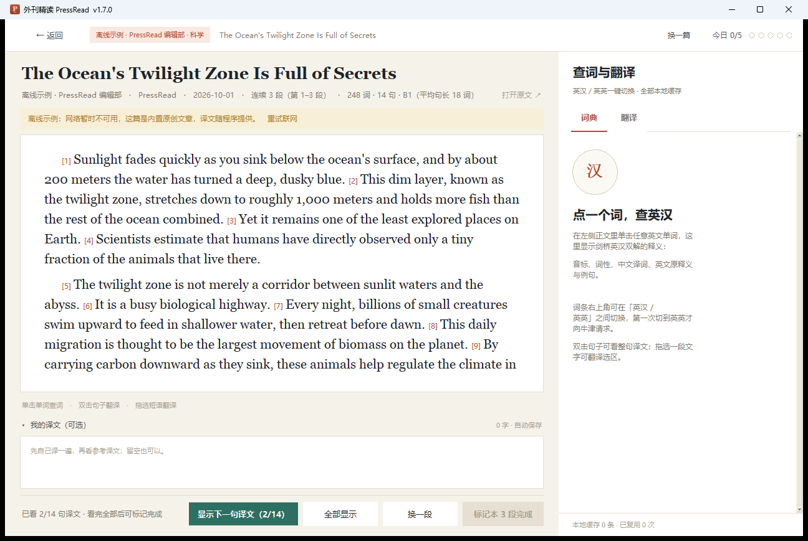
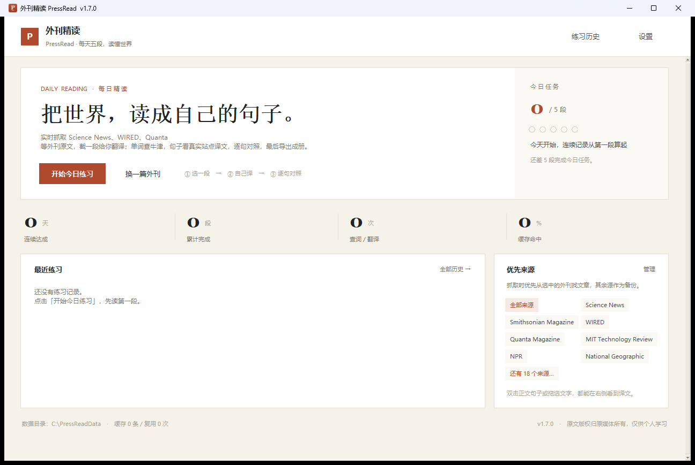
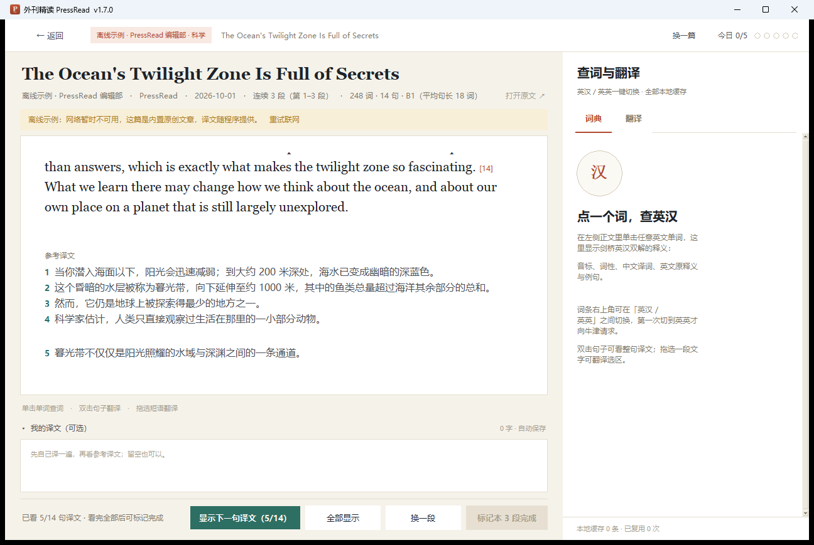
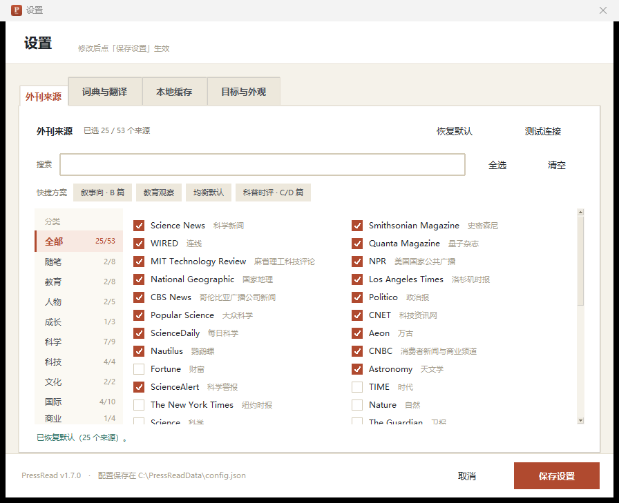
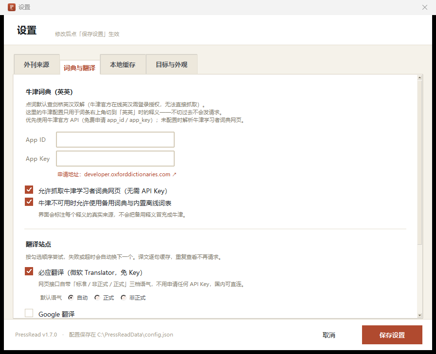

# 外刊精读 PressRead

[](https://github.com/Ghub-7121/PressRead/releases)
[](#环境要求)
[](#环境要求)
[](#环境要求)
[](#测试)
[](https://github.com/Ghub-7121/PressRead/stargazers)

**抓外刊、自己译、逐句对照。** 桌面端外刊精读工具：从 53 个外刊来源里抽一段原文，
先自己翻一遍，再点「显示下一句译文」逐句比对；查词、翻译都在右侧边栏完成，
结果落在本地 SQLite 缓存里。只用 Python 标准库，不需要 `pip install`。

[下载最新版](https://github.com/Ghub-7121/PressRead/releases) ·
[更新记录](CHANGELOG.md) ·
[历代版本](versions/README.md) ·
[问题反馈](https://github.com/Ghub-7121/PressRead/issues)



**快速跳转**：
[功能特性](#功能特性) ·
[快速开始](#快速开始) ·
[界面速览](#界面速览) ·
[使用指南](#使用指南) ·
[数据目录与缓存](#数据目录与缓存) ·
[词典与查词](#词典与查词) ·
[翻译与语气](#翻译与语气) ·
[外刊来源](#外刊来源) ·
[每日任务与导出](#每日任务与导出) ·
[设置项](#设置项) ·
[项目结构](#项目结构) ·
[测试](#测试) ·
[打包成可执行文件](#打包成可执行文件) ·
[版本历史](#版本历史) ·
[已知限制](#已知限制) ·
[参与贡献](#参与贡献)

---

## 功能特性

- **先自己译，再看答案**：不预先给译文；写完自己的版本，再逐句弹出参考译文对照。
- **查词分中英两条链路**：点词默认查剑桥英汉双解；词条右上角「英汉 │ 英英」二态开关，
  拨到英英才请求牛津，切换是原地替换同一块区域，不往下堆。
- **正式 / 非正式语气**：译文下方三档语气（自动 / 正式 / 非正式），走必应翻译，
  **不需要任何 API Key**。
- **多段同屏也按段排版**：一次显示 1–10 段，正文按段换行、首行缩进、段间留白，
  译文同样分段对齐，逐句标号与原文一一对应。
- **53 个外刊来源**：9 个分类、默认 25 个，每个都过了「能取到列表 → 能抽出正文」两步实测。
- **并发竞速抓正文**：同时向 5 个候选发请求，谁先给出可用正文就用谁；落选结果热存 1 小时。
- **每日任务与导出**：完成 N 段后导出 Markdown + JSON，文件名带自增版本号，同一天多次导出不覆盖。
- **断网不至于白屏**：内置离线示例与离线词表，全部来源失败时自动退回。
- **零第三方依赖**：`tkinter` / `sqlite3` / `urllib` / `html.parser`，克隆即可运行。

---

## 快速开始

### 方式一：下载即用（推荐）

到 [Releases](https://github.com/Ghub-7121/PressRead/releases) 下载 `PressRead.exe`：

- 单文件约 13 MB，双击运行，目标机器**不需要装 Python**。
- 首次启动要自解包，比后续启动慢 1–2 秒。
- 未做代码签名，Windows SmartScreen 可能拦一下：点「更多信息 → 仍要运行」。
- 数据目录固定在 `%APPDATA%\PressRead`，换新版 exe 不会丢缓存和练习记录。

### 方式二：从源码运行

```bash
git clone https://github.com/Ghub-7121/PressRead.git
cd PressRead

python main.py             # 正常启动：联网抓外刊
python main.py --demo      # 离线示例：不联网，直接进阅读页
python main.py --practice  # 跳过开始页，直接抓一篇开始练习
python main.py --selftest  # 环境自检：数据目录 / RSS / 正文抽取 / 词典 / 翻译
python main.py --version   # 打印版本号
```

<details>
<summary><code>--selftest</code> 输出示例（真实运行结果）</summary>

```
PressRead 1.7.0
Python 3.13.15  |  C:\Program Files\Python313\python.exe
数据目录: C:\Users\你\AppData\Roaming\PressRead
启用来源: sciencenews, smithsonian, wired, quanta, technologyreview, npr
RSS 抓取 8.8s: npr=10, smithsonian=10, wired=49, quanta=5, technologyreview=6, sciencenews=20
正文抽取: ... | 25 段 / 1177 词
牛津词典: ubiquitous | 1 义项 | 牛津学习者词典 · Oxford Learner's Dictionaries
翻译: [bing] 每天晚上，数十亿的小生物都会向上游去觅食。
```

</details>

### 环境要求

| 项目 | 要求 |
| --- | --- |
| 操作系统 | Windows 10/11（主测环境）；macOS / Linux 理论可用，截图工具仅 Windows |
| Python | **3.10 及以上**（实测 3.13.15） |
| 第三方库 | **无**。全部使用标准库（`tkinter`、`sqlite3`、`urllib`、`html.parser`、`concurrent.futures`） |
| 网络 | 能访问外刊 RSS、剑桥 / 牛津词典网页、必应翻译 |

> **必须有 tkinter**。python.org 的 Windows 安装包默认自带；微软商店版或部分精简版
> Python 会缺 `tkinter`，程序启动时会直接提示并退出（退出码 2）。
> 用 `python -c "import tkinter; print(tkinter.TkVersion)"` 可以自检。

不需要 `pip install`，克隆/解压即可运行。

---

## 界面速览

| 开始页 · 今日任务与统计 | 译文 · 按段对齐 |
| --- | --- |
|  |  |

| 查词 · 英汉（剑桥双解） | 查词 · 英英（牛津） |
| --- | --- |
|  |  |

| 来源管理 · 53 个来源分 9 类 | 词典与翻译设置 |
| --- | --- |
|  |  |

---

## 使用指南

1. **开始页**：点「开始今日练习」。首页会显示今日进度点、连续达成天数、累计段数、
   查词/翻译次数与缓存命中率。
2. **阅读页**：中间是原文，鼠标移上去单词会高亮。
   - **单击单词** → 右侧边栏「词典」页显示**剑桥英汉双解**释义（音标、词性、中文译词、
     英文原释义、例句与例句译文）。词条右上角是一个「英汉 │ 英英」两态开关：
     拨到**英英**才去查牛津，内容原地替换成英文释义；拨回**英汉**立即变回中文，
     不重新请求。同一个词两种释义各存一份缓存，切换不丢。
   - **双击句子** 或点句末的「译」小标签 → 边栏「翻译」页显示该句译文；
     译文下方有「语气」一排按钮（自动 / 正式 / 非正式），走必应翻译，
     三档都不需要 API Key，切一次按该语气重新翻译并按语气分别缓存。
   - **拖选一段文字** → 翻译选区（短语、整句都可以）。
   - **点标题右侧的「打开原文 ↗」** → 用系统默认浏览器打开这篇文章的原网页，
     想核对上下文、看配图或读全文时用。历史回看里的旧文章同样能打开。
     离线示例没有外链，按钮是灰的。
   - 原文下方是「我的译文」输入框，随手写下自己的版本，自动保存草稿。
3. **逐句对照**：看完自己写的，点「显示下一句译文」逐句弹出参考译文；
   也可以「一次显示全部」（会二次确认，跳过思考过程）。
4. **换一段**：右下角「换一段」取这篇的下一段（读完最后一段会自动换一篇新文章）。
   设置里把「一次显示段数」调成 N 时，这一屏就是连续 N 段，按钮会变成「标记本 N 段完成」。
   多段时正文**按段换行、首行缩进 2 字符、段间留白**（续行回到左边，不会整段缩进），
   下方译文也按段分组、段间空一行，逐句标签与原文一一对位。
5. **标记完成**：全部译文显示后按钮才可用（快捷键 `Ctrl+Enter`）。
   完成一段，进度点 +1；一次显示多段时按实际段数累加。达到每日目标会弹完成窗口，可直接导出。
6. **导出**：文件名形如
   `外刊精读_每日成果_20261031_v1.7.0.md`（同时生成 `.json`）。
   每次导出后版本号补丁位自增（v1.7.0 → v1.7.1），旧文件不会被覆盖。
   首页「练习历史」里可以按天回看、单独导出某一天。

---

## 数据目录与缓存

默认数据目录：`%APPDATA%\PressRead`（macOS/Linux 为用户配置目录），结构：

```
PressRead/
├── config.json          # 所有设置项
├── pressread.db         # SQLite：缓存 / 文章 / 练习 / 生词 / 导出记录
├── exports/             # 导出的 Markdown 与 JSON
├── cache/               # 预留的离线文件缓存目录
└── logs/
```

想换位置（例如放 U 盘或做测试隔离），设置环境变量即可：

```bash
set PRESSREAD_HOME=D:\PressReadData     # Windows cmd
export PRESSREAD_HOME=/tmp/pressread    # bash
```

**缓存策略**

| 内容 | 键 | 默认保留 | 说明 |
| --- | --- | --- | --- |
| 单词释义 | 规范化小写词 + `zh` / `en` scope | 30 天 | 英汉、英英各存一条，互不覆盖 |
| 句子/短语译文 | 规范化原文 + `en>zh-CN`（带语气时加 `\|formal`） | 14 天 | 同一句换文章复用，语气档分开存 |
| RSS 列表 | 来源 id | 10 分钟 | 避免反复拉 feed |
| 并发抓取的落选正文 | 文章 URL（独立表 `prefetch_cache`） | 1 小时 | 只存正文段落，下次换文章先查它 |

设置页「本地缓存」可以看统计、清理过期（按上表天数）、一键清空、打开数据目录。
缓存表带 `hits` 字段，界面上的「缓存命中率」就是它算的。

**换词典源 / 换翻译链路时会自动作废旧缓存**：`meta` 表里有一个 `cache_version`，
v1.7.0 把它升到了 3（翻译首选从 DeepL 换成必应、语气档改为必应提供；英汉/英英仍是剑桥与牛津）。
老版本升级上来第一次启动时，
程序会 `DELETE FROM cache`（词典 + 译文）并清空 `prefetch_cache`，
再写入新版本号。练习记录、生词本、导出记录、历史文章都不在清理范围内。

### 并发抓取正文

原来是一篇一篇顺着抓、抓失败才换下一篇，最坏要等好几分钟。现在改成并发竞速。

**1. 并发请求**

一次取 5 个候选（`fetch.race_width`），每个候选一个后台线程同时发请求，单篇超时
15 秒（`fetch.article_timeout`）。所有线程都是 daemon，关窗口不会被卡住的请求拖住。
另有一个全局信号量把正文请求的并发峰值压在 12 个，连点「换一篇」也不会把连接数打爆。

**2. 结果选取**

主线程按「完成顺序」取结果，**第一个能抽出正文并切成练习段的立即采用并返回**，
不等其余请求。抽不出正文（图片页、付费墙）或网络报错的候选直接跳过，继续等下一个
完成的。整批还有一个总预算 16 秒（`fetch.race_budget_seconds`），到点仍无可用结果
就放弃、退回离线示例，不会一直转圈。

**3. 缓存写入**

没被选中的请求不被丢弃：只要它们抓完并成功抽出正文，就写进 `prefetch_cache` 表
热存 1 小时（`cache.prefetch_ttl_minutes`）。下次点「换一篇」先查这张表，命中就直接
用，零网络开销。实测冷启动首次 2.8 秒，之后连续换 4 篇都是 0.01 秒。

**4. 按需清理（只清这一种）**

- 打开程序时清空整张 `prefetch_cache`：上一轮的预取结果作废。
- 运行中超过 1 小时的条目，在读取时顺手删掉。
- 这两处 SQL 只写 `prefetch_cache`，不碰 `cache`（词典/翻译）、`articles`（历史文章）、
  `feed_cache`（RSS 列表）、`practice`（每日练习）、`words`（生词本）、`exports`（导出记录）。
  单元测试 `test_purge_only_touches_prefetch_table` 专门守这条线。

**失败兜底**：单源失败只记录不阻塞；所有源都失败时退回离线示例并在状态栏提示，
不会弹错误框卡住流程。文章列表阶段也有 24 秒预算（`fetch.feed_budget_seconds`），
并且**凑够 3 个源就先开跑**，不等最慢的源。

这些参数都在 `config.json` 的 `fetch` 段里，改完重启生效；一般不用动。

---

## 词典与查词

点词默认查**英汉**，中文译词在上、英文原释义在下，例句英中对照。
词条右上角是一个「英汉 │ 英英」分段开关，当前档高亮。

| 档位 | 来源 | 说明 |
| --- | --- | --- |
| **英汉**（默认） | **剑桥英汉双解词典** | `dictionary.cambridge.org/dictionary/english-chinese-simplified/`，剑桥大学出版社，公开可访问，义项带 formal / informal 等语域标注 |
| 英汉备用 | `api.dictionaryapi.dev` | 剑桥没收录时兜底，界面标注「备用 · 英英」 |
| 英汉兜底 | 内置离线词表 `data/glossary.json` | 断网时用 |
| **英英**（按需） | **牛津学习者词典** | `oxfordlearnersdictionaries.com`，音标、词性、义项、例句、习语、词源 |

> **为什么英汉不用牛津**：牛津官方的在线英汉（《牛津高阶英汉双解词典》第 10 版，
> oalecd10.cp.com.cn）必须登录授权才能取词条，程序无法直接抓取；
> 牛津学习者词典（oxfordlearnersdictionaries.com）只有英英版。
> 因此英汉改用同为三大学习者词典的剑桥英汉双解，并在界面上如实标注来源。

**切换是「原地替换」而不是往下追加**：

- 停在**英汉**（默认）：程序**一个字节都不向牛津发**，只走上面英汉那几级。
- 拨到**英英**：才去查牛津，同一个词条区域内换成英文释义——音标保留在顶部，
  中文义项、习语、词源整块消失，徽标从「剑桥 · 英汉」（青色）变成「牛津 · 英英」（强调色）。
- 拨回**英汉**：立即变回中文，**不重新发请求**（英汉那份还在内存与缓存里）。
- 牛津还在加载时拨走：结果回来也只写缓存，不会把内容塞到你当前这一档里。
- 换成另一个词时自动回到英汉档，并把英英状态清空；下次再拨才重新查。

英汉与英英**分开缓存**（`cache` 表的 scope 分别是 `zh` / `en`），
互不覆盖；同一个词先拨英英再拨回来，两份都在。

---

## 翻译与语气

| Provider | 默认 | 语气档 | 说明 |
| --- | --- | --- | --- |
| **必应翻译**（微软 Translator） | 开 | ✅ 自动 / 正式 / 非正式 | 免 API Key，走 `cn.bing.com/translator` 页面取令牌后调 `ttranslatev3`；国内可直连，实测端到端 0.9–1.4 s |
| **MyMemory** | 开 | ❌ | 国内可直连的免费公共接口，必应不通时兜底；可填邮箱提高额度 |
| **Google 翻译** | 关 | ❌ | 走 `translate_a/single`，多数国内网络连接超时，默认关闭 |
| LibreTranslate | 关 | ❌ | 自建实例地址填进设置即启用 |

> **v1.7 为什么换掉 DeepL**：DeepL 官方 API 必须带 Key（免费额度每月 50 万字符，
> 超了就得付费）；不填 Key 时网页端 `www2.deepl.com/jsonrpc` 会连续返回
> `HTTP 429 Too many requests`，整条链路既慢又不可用。必应翻译同样是微软的
> 机器翻译引擎，同样提供正式 / 非正式语气档，且**完全不需要 Key**，
> 因此改作首选。

**语气档怎么用**

- 译文下方有一排「语气」按钮：自动 / 正式 / 非正式。
- 三档都在必应内部实现，不需要任何配置：自动档不带 `tone` 参数，
  正式档 `tone=Formal`，非正式档 `tone=Casual`。
- 实测同一个句子三档确实不同（`Hey buddy, what's up?`）：
  自动「嘿，伙计，怎么样？」／正式「你好，朋友，你怎么样？」／非正式「嘿，朋友，怎么样？」
- 当前链路里没有必应（比如设置里只勾了 MyMemory）时，后两个按钮置灰并给出提示，
  **不会偷偷用别的源冒充「正式译法」**。
- 切一次语气 = 按该语气重新请求，缓存按语气分开存（`en>zh-CN|formal`），
  来回切换不会互相覆盖，也不会重复请求。

**必应的令牌机制**：先 GET 一次翻译页，正则取 `IG`、`data-iid` 与
`params_AbusePreventionHelper` 里的 `[key, token, ttl]`，再 POST `ttranslatev3`。
令牌缓存到过期前 2 分钟复用，所以连续翻译只在第一次多花一次页面请求（约 0.3 s）。
令牌失效时接口会回空 body 或 `statusCode=205`，程序会强制重取页面再重试一次。

其他细节：

- 长文本按句切块（900 字符/块），分段请求后拼接，避免超长被截断。
- 同一句同一语气 14 天内复用缓存，边栏会标「来自本地缓存」。
- 单源超时 9 秒且不重试（`PROVIDER_TIMEOUT`），不通的源立刻让位给下一个，
  不会把每句都拖到全局 18 秒；某 provider 连续失败 2 次熔断 2 分钟。
- **机器译文只作参考**，精读的重点还是自己先译一遍。

---

## 外刊来源

共 **53 个来源**（9 个分类），默认勾选 **25 个**。每个来源都做过「RSS/列表页能取到 → 文章页能抽出正文」两步实测，两步都通过才设为默认。

目录分两条线：

- **新闻/科普线**（科学、科技、文化、国际、商业）：练信息密度、术语和长难句，对应试卷的 C/D 篇。
- **B 篇线**（随笔、教育、人物、成长）：按「有人物、有具体场景、中段有转折、结尾能提炼出道理」挑选，多为专业领域的中小刊物，而不是《经济学人》《卫报》这类大报名刊。

### B 篇线（v1.4 新增）

| 来源 | 类别 | 默认 | 为什么收 |
| --- | --- | --- | --- |
| **The American Scholar** | 随笔 | ✅ | Phi Beta Kappa 学会人文季刊，Essays 栏目＝「生活小事引出人生思考」的标准记叙文 |
| Narratively | 随笔 | ✅ | 第一人称非虚构，短、集中、转折清楚 |
| Brevity | 随笔 | ⬜ | 极短篇非虚构，一篇一个场景、一个顿悟 |
| Literary Hub | 随笔 | ⬜ | 作家随笔与文学评论，叙述性长句多 |
| Yes! Magazine | 随笔 | ⬜ | 解决方案导向，从具体的人讲起 |
| Orion Magazine | 随笔 | ⬜ | 自然与地方生活随笔，观察细致（无 RSS，走列表页） |
| Hippocampus Magazine | 随笔 | ⬜ | 回忆录式非虚构，家庭记忆题材集中 |
| The Christian Science Monitor | 随笔 | ⬜ | Home Forum 是个人随笔专版，与 B 篇最接近；当前网络不可达 |
| **Edutopia** | 教育 | ✅ | 教师课堂实践与反思，常写「我改了什么、学生变了什么」（无 RSS，走列表页） |
| Inside Higher Ed | 教育 | ⬜ | 高校新闻与观点，师生故事多 |
| **Cult of Pedagogy** | 教育 | ✅ | 一线教师教学反思，叙事完整 |
| Faculty Focus | 教育 | ⬜ | 高校教师教学札记，短小 |
| The 74 | 教育 | ⬜ | K-12 教育调查与人物报道 |
| Education Next | 教育 | ⬜ | 教育政策评论，观点文偏多 |
| eSchool News | 教育 | ⬜ | 教育技术新闻，篇幅短 |
| Education Week | 教育 | ⬜ | 命题组高频取材地，Opinion 版最贴近 B 篇；源站反爬，当前返回 403 |
| **Guideposts** | 人物 | ✅ | 励志真实故事，普通人的困境与转机 |
| **StoryCorps** | 人物 | ✅ | 普通人讲述亲身经历，口语化、有场景 |
| The Big Issue | 人物 | ⬜ | 英国街头杂志，劳动者与弱势群体特写 |
| Positive News | 人物 | ⬜ | 建设性新闻，聚焦人如何解决问题 |
| Reader's Digest | 人物 | ⬜ | 人物特写经典来源；源站反爬，当前返回 403 |
| **Fatherly** | 成长 | ✅ | 父亲视角的家庭生活报道 |
| Motherly | 成长 | ⬜ | 母亲与家庭题材，第一人称多 |
| Science News Explores | 成长 | ⬜ | 面向青少年的科普，句子短、解释清楚 |

**这几个为什么默认关**：Education Week、Reader's Digest、CS Monitor 是资料里点名的高频来源，但当前网络分别返回 403 / 403 / 502（CS Monitor 是代理层直接断开），默认打开只会拖慢首篇加载。程序里保留条目并在简介注明原因，换网络环境可以在设置里直接勾上。

### 新闻 / 科普线

| 来源 | 类别 | 默认 | 备注 |
| --- | --- | --- | --- |
| Science News / Quanta / ScienceDaily / Nautilus / Astronomy / ScienceAlert | 科学 | ✅ | 科普与科研新闻，术语密集 |
| **National Geographic** | 科学 | ✅ | 官网已停 RSS，走列表页解析 |
| WIRED / MIT Technology Review / Popular Science / CNET | 科技 | ✅ | 科技文化与产业分析 |
| Smithsonian / Aeon | 文化 | ✅ | 历史艺术、哲学长文 |
| NPR / **Los Angeles Times** / **CBS News** / **Politico** | 国际 | ✅ | 新闻文体，句式规整 |
| CNBC | 商业 | ✅ | 市场与宏观经济 |
| **TIME / The New York Times** | 国际 | ⬜ | 当前网络 TCP 超时，换网络可试 |
| Nature / Science / The Guardian / BBC / France 24 / UN News | 科学·国际 | ⬜ | 学术或时政，多数网络不稳定 |
| The Economist / WSJ / Fortune | 商业 | ⬜ | 订阅墙，或 feed 偶发很慢 |

**关于「没有 RSS 的站点」**：National Geographic、Edutopia、Orion 的官方 RSS 或已停更、或从未提供，程序改为抓栏目页，按 `link_pattern`（如 `/article/`）挑链接、标题取卡片上的 `aria-label`。这类来源在 `feeds.Source` 里标记为 `kind="html"`，走 `parse_listing()` 而不是 `parse_feed()`。

**没有收录的站点**（实测被反爬或网络拦住，收录只会产生错误）：
Ars Technica（405）、Phys.org（403）、Undark（403）、Longreads（403）、The Rumpus（403）、Guernica 正文（403）、KQED MindShift 正文（403）、Times Higher Education（502）、Washington Post（502）、TIME for Kids（502）、EdSurge（404）、The Chronicle（404）、DOGOnews（403）、Atlas Obscura（正文仅 75 词）。

抓取失败只会记录并跳过，不会卡住整个流程；全部来源失败时，若开启了
「网络抓不到文章时自动打开离线示例」，会退到内置示例，保证程序可用。

### 来源管理（v1.4 重构）

来源从 29 涨到 53 以后，原来的「一条长列表逐个翻、逐个点」不好用了，设置页改成四件事：

- **左侧分类导航**：全部 / 随笔 / 教育 / 人物 / 成长 / 科学 / 科技 / 文化 / 国际 / 商业，每项右侧显示「已选 / 总数」，点一下只看这一类。
- **关键词搜索**：英文名、中文名、简介、分类都能搜；空格分隔多个词表示「都要命中」，例如「教育 周刊」。按 Esc 清空。
- **批量操作**：全选 / 清空只作用于**当前筛选结果**，不会误伤其他分类。
- **快捷方案**：叙事向·B 篇（20 个）/ 教育观察（7 个）/ 均衡默认（25 个）/ 科普时评·C/D（14 个），一键切换整套配置；「恢复默认」回到出厂状态。

行高从三行压到 26px、两列排布，53 个来源一屏能看到 20 多个；每个来源的简介改成悬停显示在底部一行，不再占版面。

---

## 每日任务与导出

- 每日目标默认 **5 段**（设置里 1–10 可调），按本地日期统计，跨天自动重置。
- 一段 = 45–130 词的连续原文（过短的段落会自动与相邻段合并，避免出现 18 词的碎片）。
- 「一次显示段数」（设置 → 目标与外观，默认 1、可调 1–10）决定每屏抽多少段：
  取连续的 N 个段落合成一屏，正文之间空行分隔、逐句译文顺序拼接；
  **文章剩余不足 N 段时取最多能取的段数**，因此不会因为设置过大而抽不到内容。
  完成一次按实际段数计入每日进度（例如设 3 段、文章只剩 2 段，就记 2 段）。
- 完成判定：该段全部译文已显示 → 点「标记完成」→ 写入 `practice` 表。
- 「连续达成」= 从今天（今天没完成则从昨天）往前数，连续满足目标的天数。
- 导出内容：日期、版本、完成段数、每段的原文 / 我的译文 / 参考译文（逐句）、来源与完成时间。
- 版本号存放在 `meta.export_version`，导出时取当前值再自增，因此**同一天多次导出不会覆盖**。

---

## 设置项

| 标签页 | 可调项 |
| --- | --- |
| 外刊来源 | 53 个来源分 9 类：分类导航 + 关键词搜索 + 全选/清空 + 快捷方案，另有「测试连接」并行验证哪些可用 |
| 词典与翻译 | 牛津 app_id/app_key、是否允许网页解析、是否允许备用词典（以上仅影响切到「英英」时的牛津释义）；翻译 provider、是否启用必应翻译、默认语气（自动/正式/非正式）、MyMemory 邮箱、LibreTranslate 地址 |
| 本地缓存 | 统计（含预取正文篇数）、清理过期、清空、打开数据目录 |
| 目标与外观 | 每日目标段数、一次显示段数（1–10）、阅读字号（12–24pt 实时预览）、断网时是否使用离线示例 |

保存时会校验：至少一个来源、牛津 id/key 必须成对、至少一个翻译源。

---

## 项目结构

```
PressRead/
├── main.py                  入口：--demo / --practice / --smoke / --selftest / --version
├── pressread/
│   ├── paths.py             数据目录、资源路径（兼容 PyInstaller _MEIPASS）
│   ├── config.py            JSON 配置 + 默认值深合并
│   ├── store.py             SQLite：缓存、文章、feed、预取正文、练习、生词、导出
│   ├── fetch.py             urllib 封装：重试、gzip、编码探测、主机熔断
│   ├── htmltree.py          极简 DOM（HTMLParser）+ 链接密度
│   ├── textproc.py          分句/分词/清洗/样板过滤/难度估计
│   ├── article.py           正文抽取（容器投票 + JSON-LD 兜底）、练习段落切分
│   ├── feeds.py             53 个来源 + 快捷方案 + 搜索筛选 + RSS/Atom 与列表页解析
│   ├── dictionary.py        牛津 API / 牛津网页 / 备用词典 / 离线词表 + 缓存
│   ├── translate.py         必应 / MyMemory / Google / Libre + 三档语气、分块、熔断、缓存
│   ├── service.py           并发竞速抓正文、预取缓存、挑文章、离线兜底
│   ├── daily.py             每日任务、草稿、连续天数
│   ├── exporter.py          Markdown/JSON 导出与版本号自增
│   ├── context.py           依赖装配（config/store/http/dict/translate/...）
│   └── ui/
│       ├── theme.py         配色、字体、ttk 样式
│       ├── widgets.py       滚动区、进度点、自绘复选框/滑块、Toast、Tooltip
│       ├── workers.py       ThreadPoolExecutor + 队列轮询（Tk 单线程安全）
│       ├── start.py         开始页
│       ├── reader.py        阅读页、完成弹窗
│       ├── sidebar.py       右侧查词/翻译边栏
│       ├── history.py       练习历史
│       ├── settings.py      设置窗口
│       └── app.py           主窗口与路由
├── data/
│   ├── demo_article.json    离线示例（3 段，含逐句译文）
│   └── glossary.json        离线备用词表
├── assets/app.ico           程序图标（16–256 多尺寸）
├── tools/
│   ├── capture.py           开发用窗口截图（Windows GDI，无第三方依赖）
│   ├── make_icon.py         生成 app.ico（需要 Pillow，仅打包前用一次）
│   ├── build_exe.py         PyInstaller 打包脚本（含打包后自检）
│   └── shot_exe.py          抓打包后 exe 的窗口截图（QA 用）
├── preview/                 界面截图（README 展示用）
├── CHANGELOG.md             全版本更新记录（1.0.0 → 当前）
├── versions/<版本号>/       历代版本：发布记录 + 归档 exe（索引见 versions/README.md）
├── dist/PressRead.exe       本地打包产物（已在 .gitignore 中，不入库）
└── tests/                   单元测试 + GUI 冒烟测试 + fixture
```

线程模型：Tk 只在主线程碰；界面发起的网络请求走 `TaskRunner`（线程池 + 队列 + `after(50)` 轮询），
切段/重查时旧任务会被 `Job.cancel()` 丢弃，迟到的结果不会覆盖新界面。
抓取正文的竞速线程由 `ArticleService` 自己开（daemon 线程 + `queue` 回收结果），
主线程拿到第一个可用结果就返回，落选线程继续跑完并把正文写进预取缓存。

---

## 测试

```bash
python tests/run_tests.py          # 218 个单元测试，约 3 秒
python tests/run_tests.py --gui    # 追加离线 GUI 冒烟测试（截图到 tests/shots）
python tests/smoke_test.py --online  # 冒烟 + 真实查词/翻译链路（需网络）
```

- 单元测试覆盖：分句（缩写/小数/引号/省略号）、样板过滤、正文抽取（含图注、导航、
  JSON-LD 兜底）、RSS/Atom 解析、牛津网页/API 解析、备用词典、缓存命中与熔断、
  必应令牌获取与三档语气（含令牌过期重取、`statusCode=205` 重试、页面结构变更报错）、
  段落起点计算、每日任务、导出内容与版本号、SQLite 各表。
- GUI 冒烟测试不联网：用离线示例 + 预置词典缓存，走完「开始页 → 阅读 → 查词 →
  逐句揭示 → 标记完成 → 历史 → 设置」并用 `PrintWindow` 截图，便于肉眼复核。
  其中「一次显示多段」「多段正文含分段空行」「多段译文逐句对齐」三项专门盯分段缩进；
  「英英未切换不加载」「切到英英才查牛津」「英英原地替换英汉」「切回英汉不重新请求」
  四项专门盯双状态开关——断言的是「英英文字出现且英汉文字消失」，能抓出「往下追加」的回退。
- 冒烟测试默认在 `.tmp_home/smoke` 建临时数据目录，可用 `PRESSREAD_SMOKE_HOME` 指到别处
  （例如打截图给 README 用时，避免界面状态栏出现项目路径）。

---

## 打包成可执行文件

仓库不收录二进制，成品挂在 [Releases](https://github.com/Ghub-7121/PressRead/releases)：
**单文件，约 13 MB，双击即用**，目标机器不需要装 Python。
首次启动会自解包到临时目录，比后续启动慢 1–2 秒。

自己重新打包（Windows 产物为 `dist/PressRead.exe`）：

```bash
# 1) 建打包环境（PyInstaller 只在打包时用，不是运行依赖）
python -m venv .venv
.venv\Scripts\activate          # macOS / Linux: source .venv/bin/activate
pip install pyinstaller

# 2) 打包：写版本资源与图标，打完自动跑一次 exe 自检
python tools/build_exe.py --clean
```

常用开关：

```bash
python tools/build_exe.py --console   # 控制台版，能看 print 和异常堆栈
python tools/build_exe.py --no-smoke  # 只打包，不做打包后自检
```

打包内容与约定：

| 项 | 说明 |
| --- | --- |
| 入口 / 形态 | `main.py`，`--onefile --windowed`（不弹黑框） |
| 随包资源 | `data/`（离线示例、词表）、`assets/app.ico` |
| 版本信息 | 从 `pressread/__init__.py` 读取，写入 exe 属性（文件版本 1.7.0） |
| 图标 | `assets/app.ico`，标题栏与任务栏一致；重新生成用 `tools/make_icon.py` |
| 数据目录 | 仍是 `%APPDATA%\PressRead`，换新版 exe 不会丢缓存和练习记录 |

打包后的自检（不需要点界面）：

```bash
dist/PressRead.exe --smoke     # 资源 / tkinter / 主窗口 / 离线示例，结果写 exe 同目录 exe_smoke.txt
dist/PressRead.exe --selftest  # 联网自检，结果写 %APPDATA%\PressRead\logs\selftest.txt
```

> GUI 版没有控制台，`--selftest` 的输出除了打印，一定同时写进上面的日志文件。
> `--smoke` 的结果可用 `PRESSREAD_SMOKE_OUT` 改路径。

---

## 版本历史

- **全量改动**：[`CHANGELOG.md`](CHANGELOG.md)，从 1.0.0 到当前 1.7.0，一版一节。
- **每版发布记录与成品**：[`versions/`](versions/README.md)，一个版本一个文件夹，
  含 `RELEASE_NOTES.md`；有归档的版本另附 `PressRead-<版本号>.exe`。索引见 `versions/README.md`。
- **当前版本**：1.7.0（`pressread/__init__.py` 的 `__version__`，exe 文件属性同源）。
- **编号规则**：第二位升号 = 新增用户能感知的功能；第三位升号 = 修 bug / 调文案 / 改兼容，不加功能。
- **† 标记**：回溯补记。1.6.0 同批构建里有两处修复当时没单独编号，现补记为 1.6.1† / 1.6.2†，
  只有说明、没有独立成品；其余版本的同类修复均在打包前完成，已计入各自版本。
- **成品现状**：1.0.0–1.6.0 每次重打包都覆盖 `dist/PressRead.exe`，历史二进制没有留存，只有发布记录；
  1.7.0 起把每版 exe 归档进 `versions/<版本号>/`，同时挂到
  [GitHub Releases](https://github.com/Ghub-7121/PressRead/releases)。

---

## 已知限制

1. **网络依赖**：TIME、纽约时报、Google 翻译、BBC、Nature 等在当前网络下不可达，
   程序会自动跳过；换网络环境可在设置里打开对应来源。
2. **订阅墙**：The Economist / WSJ 等即使 RSS 可读，正文也可能只返回摘要，
   此时会退化为「RSS 摘要」文章（长度不足时会提示换一篇）。
3. **机器译文仅供参考**。必应免 Key 通道是公开网页接口，极端情况下可能限流；
   MyMemory 免费额度也有限（填邮箱可提高），超限会提示明天再试。
4. **牛津网页结构会变**，解析规则失效时请改用官方 API；
   必应翻译页的令牌字段（`IG` / `params_AbusePreventionHelper`）同理，
   页面改版报错会明确提示「页面结构可能已变」。
5. 段落切分、难度（A2–C2）都是启发式估计，只用于提示，不作评分。
6. **英汉释义来自剑桥**：牛津官方在线英汉需要登录授权，无法抓取；牛津只提供英英。
   想要牛津英汉可自行在牛津官网查询，程序内点击「剑桥官网 ↗」也能看原词条。
7. 截图工具 `tools/capture.py` 仅支持 Windows。
8. **exe 未做代码签名**，首次运行可能被 SmartScreen 拦下，点「更多信息 → 仍要运行」即可；
   杀软对 PyInstaller 单文件偶尔误报，加白名单即可。

---

## 参与贡献

- **报问题**：开 [Issue](https://github.com/Ghub-7121/PressRead/issues)，附上版本号
  （`python main.py --version`）、复现步骤；抓取类问题请注明来源名与大概时间。
- **提 PR**：从 `main` 切分支，改完先把测试跑一遍：

  ```bash
  python tests/run_tests.py
  python tests/run_tests.py --gui
  ```

- **代码约定**：只用标准库；改词典或翻译链路时，同时更新 `tests/` 与本文档里的说明表；
  新增来源必须「列表能取到 + 正文能抽出」两条都过，才设为默认。
- **加来源**：改 `pressread/feeds.py` 的 `SOURCES`（分类、默认开关、一句简介），
  再在本文「外刊来源」一节登记。
- 这个项目对你有用的话，点个 Star 就是最好的支持。

---

## 版权与许可

- 抓取的原文版权归原媒体所有，程序仅在本地展示，导出的 Markdown / JSON 仅供个人语言学习使用，
  请勿二次分发。
- 除查词（剑桥 / 牛津）与翻译（所选 provider）外，不上传任何内容；缓存与练习记录只存在本机，
  不收集任何使用统计。
- 本仓库代码可自由阅读、fork、修改用于个人学习；**转载、商用或再分发前请先开 Issue 联系作者**。
- 词典释义与机器译文分别来自剑桥大学出版社、牛津大学出版社与微软 Translator，界面内已标注当前来源。
